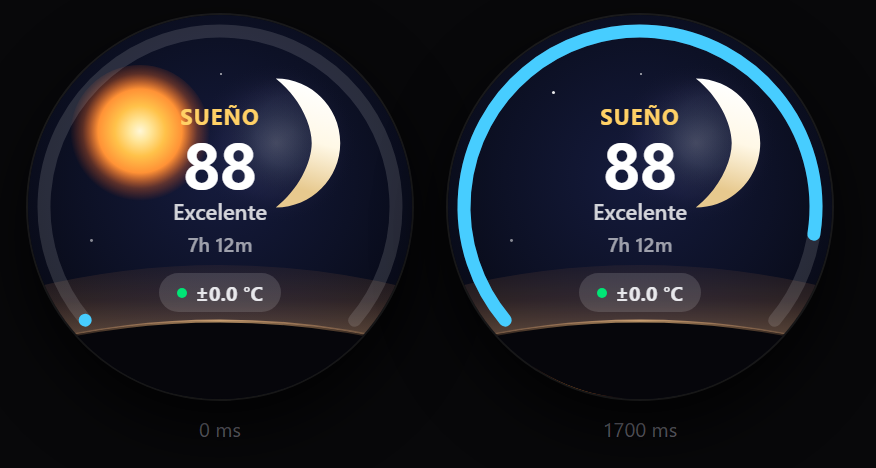
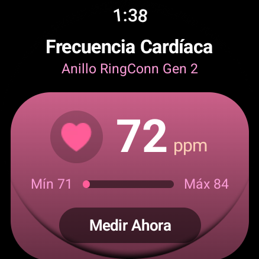
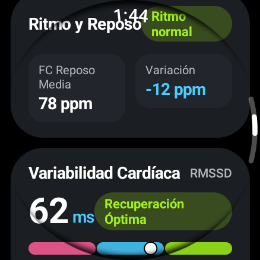
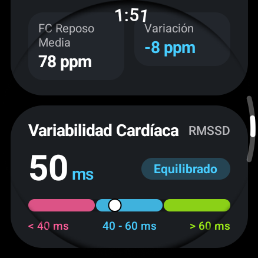
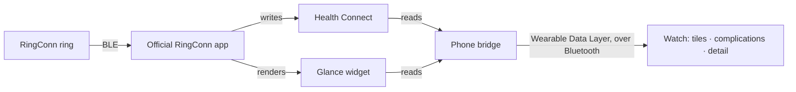

# RingConnWearSync

Use the RingConn smart ring as the biometric source for a Samsung Galaxy Watch: five One UI tiles,
seven watch-face complications, and detail screens, fed by the ring instead of the watch's own
sensors.

[](https://github.com/Hardbas/RingConnWearSync/actions/workflows/ci.yml)
[](https://github.com/Hardbas/RingConnWearSync/releases/latest)
[](LICENSE)



<sub>Sleep tile, two frames of its entrance animation. Rendered from the app's own vector drawables,
not from a mockup.</sub>

  

<sub>Detail screens captured on a Galaxy Watch 8 (438×438). Spanish locale throughout: it is the same
build, with the translated strings.</sub>

## Why this exists

Dark tattoo ink blocks the optical sensor on a Galaxy Watch, so heart rate and SpO2 read as nothing
or as noise. The ring does not have that problem. This project takes the ring's numbers and puts
them where the watch already shows its own: the tiles, the complications and the detail screens.

It is not a replacement for Samsung Health or for the RingConn app. It moves one number from one
device to another, and it stays out of the cloud while doing it.

## Install

The app is sideloaded. It does not need root, it does not unlock the bootloader, and it does not
trip the Knox warranty bit — Samsung Pay and Google Wallet keep working.

1. **Phone.** Download [`RingConnWearSync-Phone-v*.apk`](https://github.com/Hardbas/RingConnWearSync/releases/latest)
   and install it, allowing installs from your browser or file manager. Grant Health Connect
   permissions when the app asks, and turn on the accessibility service it needs to read the
   RingConn app's screen.
2. **Watch.** Enable ADB debugging over Wi-Fi in the watch's developer options, then:

   ```bash
   adb connect <watch-ip>:<port>
   adb install -r RingConnWearSync-Watch-v*.apk
   ```

   `-r` matters: it replaces the app without wiping the tiles and complications you configured.
3. **First sync.** Open the official RingConn app once so it initialises its own widget. Everything
   downstream reads that widget or Health Connect, so until it runs there is nothing to read.

ADB is only needed for the install. Once both APKs are on the devices, debugging can be turned off.

> [!IMPORTANT]
> Keep the RingConn app installed. It is the only component with a Bluetooth connection to the
> ring, and this project reads what it publishes.

## What you get

**Tiles** — heart rate, stress, sleep with nocturnal skin temperature, daily activity, and a
combined vitals view. They follow the One UI Watch stadium proportions so they sit next to
Samsung's own tiles without looking bolted on.

**Complications** — ring battery, heart rate, SpO2, sleep score, steps, stress and skin temperature.
Each answers every complication type the watch asks for, including `RANGED_VALUE` and
`GOAL_PROGRESS`, and taps through to the matching detail screen.

**Detail screens** — the same metrics, with the range, the stages, and the zones behind the single
number the tile shows.

## Limits

Read this before opening an issue; most surprises live here.

- **The sleep chain has three hops, and the first one is theirs.** `ring → RingConn app → Health
  Connect (or its widget) → this app`. The ring only syncs to Health Connect while the official app
  is running, so a night for which it was never opened simply is not there yet. Opening the app
  once in the morning is what makes the last night appear. There is no other component with BLE
  access to the ring.
- **The bridge tries to do that opening for you, and fails safely.** It launches the official app,
  waits up to 24 seconds for the sleep card, then returns home. It aborts if the app is not in
  front after 6 seconds, which is what happens when the phone is locked: the keyguard owns the
  screen and this app does not force itself over it.
- **Anything read from the widget lags by that widget's own refresh.** RingConn refreshes it every
  15–30 minutes, so sleep score, HRV, stress, ring battery and skin temperature can trail the
  official app by up to half an hour. Polling faster produces no fresher data, only battery drain,
  which is why the poll backs off overnight.
- **A missing value can render as a zero.** The phone-to-watch transport sends numbers, not
  absence, so a stage that was never measured arrives as `0 m` instead of `--`. If Awake shows 0
  while Deep and REM look plausible, that is this limitation, not a night without awakenings.
- **Sleep stages are assigned in 30-second epochs.** Totals can still differ from the official app
  where fragments overlap: this app unions them rather than summing.
- **Two paths are untested on hardware.** The `GOAL_PROGRESS` complication needs API 33, and the
  app supports API 30; the theme fallback for Android 8 and 9 has never run on those devices.

If a morning reading looks wrong, open the RingConn app with the phone unlocked, let it sync, and
reopen the watch screen. Still wrong after that is worth an issue, and the in-app **Copy
diagnostics** button gives you a report with the build, the device and what Health Connect actually
returned.

## How it works



The phone bridge reads two sources and pushes the result to the watch. Nothing is sent anywhere
else: the app requests no network permission at all, and a unit test fails the build if one
reappears in the manifest.

| Metric | Source | Why there |
|---|---|---|
| Heart rate, SpO2, sleep sessions, steps, calories, HRV, resting HR, skin temperature | Health Connect | Standard API, user-authorised |
| Sleep score, stress index, ring battery, widget-side HRV and temperature | RingConn's Glance widget | RingConn does not export these to Health Connect |

### Values that are estimated, not measured

Some cards show numbers the ring never measures directly. They carry a `· EST` chip (or `≈` on
tiles) and are indicators, not measurements:

| Value | Derivation |
|---|---|
| Basal calories | elapsed minutes × 1.166 kcal — ignores weight, age and sex |
| Distance | steps × 0.000762 — one fixed 76.2 cm stride for everyone |
| Respiratory rate | 14.2 + (avg HR − 60) × 0.07 − (avg HRV − 45) × 0.02 |
| Heart rate per sleep stage | nightly minimum + 1/4/6 BPM, a stage-correlation heuristic |
| Sleep efficiency | asleep ÷ in-bed, else sleep score + 5 |
| Circadian stress blocks | 4 × 6 h blocks, block HR mean against the nightly baseline |

Values that cannot be derived render as `--`. Earlier releases published estimated blood pressure,
dehydration risk, migraine risk and body balance. Those were removed: a fabricated clinical figure
is indistinguishable from a measurement once it is on a watch face.

## Compatibility

| | |
|---|---|
| Watch | Galaxy Watch 4, 5, 6, 7, Ultra, 8 Classic — Wear OS 4/5, One UI Watch 5/6/8. Other Wear OS devices get complications and detail screens, not the One UI tile treatment |
| Phone | Android 12 or newer, with Health Connect available |
| Not supported | iOS and Apple Watch: watchOS cannot sideload an APK and has no Wearable Data Layer |

## Staying up to date

There is no in-app updater, on purpose: an updater would mean the app making network requests,
which would contradict the privacy statement. Updates are your decision:

- **Releases** — <https://github.com/Hardbas/RingConnWearSync/releases/latest> always points at the
  newest build.
- **Notifications** — on the repository, *Watch → Custom → Releases*. GitHub emails you; nothing is
  sent to the app.
- **CHANGELOG.md** — what changed in each version, so you can decide whether two minutes of
  reinstalling is worth it.

Update by installing over the current version. Every release is signed with the same certificate,
so Android treats it as an update and keeps your Health Connect grants and your layout.

## Verifying what you download

Every release APK is signed with one certificate. Confirm that the file you have is the one
published here:

```bash
apksigner verify --print-certs RingConnWearSync-Phone-v*.apk
apksigner verify --print-certs RingConnWearSync-Watch-v*.apk
```

Both must report this SHA-256 digest:

```
1ccf5348ff46a919620d806faa9a5e0e9d857bc74fdb643809ea3108827f1372
```

The same value lives in [`signing-identity.properties`](signing-identity.properties), and
`scripts/check-release-signing-identity.sh` refuses any key or APK that carries a different one. It
is a step in the release checklist, not a build hook: a release is only as verified as the person
cutting it. If the file and this page disagree, the file wins.

`apksigner` ships with the Android SDK build tools; without the SDK, the same digest can be read
from the APK's `META-INF` with `keytool -printcert`.

The certificate subject still reads `CN=Android Debug`, because that is the key this project began
on and changing it would strand every existing install. The subject is not the identity; the digest
above is, and it is the same one every release has carried.

## Building it

Requires JDK 21 and Android SDK Platform 35.

```bash
./gradlew :mobile:testDebugUnitTest :wear:testDebugUnitTest   # unit tests
./gradlew :mobile:lintDebug :wear:lintDebug                   # lint; errors fail CI
./gradlew :mobile:assembleDebug :wear:assembleDebug           # installable APKs
```

CI runs exactly that on every pull request, plus two shell guards: the tag must name the version in
`version.properties`, and a watch label that does not fit its surface fails the build instead of
rendering as `Rhythm and…`.

- [CONTRIBUTING.md](CONTRIBUTING.md) — clean-room interoperability rules, commit conventions, how
  to submit a patch. Read the clean-room section before changing the parser.
- [RELEASING.md](RELEASING.md) — the version source of truth, the release gate, and how the signing
  key is backed up.
- [SECURITY.md](SECURITY.md) — threat model and how to report a vulnerability privately.
- [CODE_OF_CONDUCT.md](CODE_OF_CONDUCT.md) — Contributor Covenant 2.1.

Questions belong in [Discussions](https://github.com/Hardbas/RingConnWearSync/discussions); bugs
and parser breakage belong in [Issues](https://github.com/Hardbas/RingConnWearSync/issues).

## How this was written

Most of the source in this repository was written by AI coding agents, directed and reviewed by a
human maintainer. The Kotlin and ProtoLayout implementation, the unit tests and their contracts, the
vector drawables and most of the prose in this README came out of that loop.

The human defined the required behaviour and the design targets, chose the architecture and the
legal posture, reviewed every diff, and verified releases on a Galaxy Watch 8 and an S25 Ultra
before tagging them.

The gates are the same either way: unit tests, Android Lint, the two shell guards, and a release
that must assemble before a tag can exist. Judge the code on its own merits, and open an issue if
something in it is wrong.

## Legal

Interoperability, clean-room. This project reads data the RingConn app already publishes on the
user's own device and displays it on the user's own watch. It contains no RingConn code, no Samsung
code, and no extracted artwork: images of unclear provenance are replaced with original vector
drawables. "RingConn" and "Samsung" are trademarks of their owners, used only to describe what this
software interoperates with. Not affiliated with, endorsed by, or supported by either company. See
[NOTICE.md](NOTICE.md) for the full disclosure.

## License

MIT — see [LICENSE](LICENSE).
